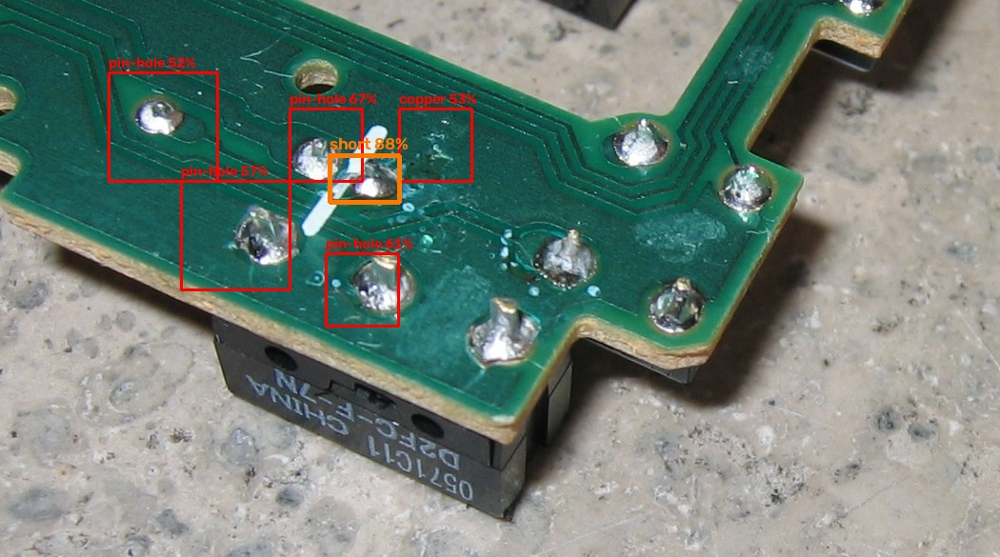

# PCB Defect Detection (board-aware, 6 defect classes)

Detects **copper, mousebite, open, pin-hole, short, spur** on PCB photos.


Red = CNN detections (only inside the localized board). Orange = optional detailed review boxes.

## Why this version
The original model reported "100%" only because train and validation shared boards, and it flagged anything in the photo
(background, hands, text) as a defect. This version:
- finds the PCB first and only searches inside it,
- adds a **background** class (trained on defect-free boards + junk patches),
- validates on **whole held-out board groups**,
- uses colour/lighting/blur/noise augmentation with identical preprocessing in training and inference.

Honest numbers (15 held-out boards, confidence 0.5): 86% recall / 5.3 false alarms per board on DeepPCB-style images;
57% / 8.9 on synthetic colour photos. See [REPORT.md](REPORT.md). Real-photo recall is **not** measured (no labels).

## Quick start (VS Code)
```bash
git clone <this-repo-url>
cd <repo>
python -m venv .venv
# Windows: .venv\Scripts\activate    macOS/Linux: source .venv/bin/activate
pip install -r requirements.txt
streamlit run app_v2.py
```
In VS Code: open the folder, select the `.venv` interpreter, press **F5** and choose "Run AOI app (Streamlit)".
Upload a PCB photo; the confidence slider defaults to 50%.

The optional "Detailed defect review" panel reads its settings from the environment variables listed in `.env.example`.

## Train / evaluate
```bash
git clone --depth 1 https://github.com/tangsanli5201/DeepPCB.git
cd DeepPCB
python ../6_train_robust.py        # writes pcb_cnn_model_v2.keras (Colab T4 ~15 min, CPU ~35 min)
python ../7_evaluate.py --n 15
```
`pcb_train_colab.ipynb` runs the same training on Google Colab.

## Files
`pcb_common.py` board localization, windows, preprocessing · `6_train_robust.py` training · `7_evaluate.py`, `sweep.py` metrics ·
`app_v2.py` Streamlit app · `gemini_review.py` optional review · `pcb_cnn_model_v2.keras` trained model.

Data: [DeepPCB](https://github.com/tangsanli5201/DeepPCB). Always verify defects manually.

## Image credit
`docs/example_detection.jpg` is derived from "Mouse PCB damaged IMG 1716" from Wikimedia Commons, licensed CC BY-SA 3.0 (https://commons.wikimedia.org/wiki/File:Mouse_PCB_damaged_IMG_1716.JPG). Annotations added.
